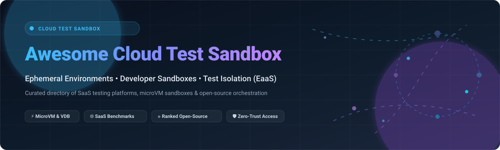

  

# 🧪 Awesome Cloud Test Sandbox

  
  
  
  
  
  
  

> 🚀 A curated list of top SaaS platforms, Environment-as-a-Service (EaaS) tools, and open-source projects for **Cloud Test Sandboxes**, **ephemeral environments**, and **developer test isolation**.

---

## 📖 Overview

Modern software development requires reliable, fast, disposable, and reproducible environments for testing, QA, CI/CD validation, and demos. **Cloud Test Sandboxes** enable platform teams, DevOps engineers, and developers to spin up isolated workloads without polluting production or incurring runaway infrastructure costs.

Whether you need enterprise-managed multi-tenant sandbox platforms, secure microVM runtimes, or Kubernetes-native ephemeral namespaces, this guide tracks the best solutions available across SaaS and open source.

---

## 📑 Table of Contents

- [📊 Sector Overview & Market Dynamics](#-sector-overview--market-dynamics)
- [☁️ SaaS & Hosted Platforms](#️-saas--hosted-platforms)
- [🛠️ Open-Source GitHub Projects](#️-open-source-github-projects)
- [🏗️ Architecture & Framework Ideas](#️-architecture--framework-ideas)
- [📈 Star History](#-star-history)
- [💖 Support](#-support)
- [🤝 How to Contribute](#-how-to-contribute)
- [📜 Disclaimer & License](#-disclaimer--license)

---

## 📊 Sector Overview & Market Dynamics

The global market for **Test Environment as a Service (TEaaS)** and cloud testing sandboxes is estimated at **$17.7 billion in 2025** (with the dedicated cybersecurity cloud sandboxing sub-segment at ~$3.1 billion to $3.7 billion), growing rapidly toward $60+ billion by 2034.

The sector exhibits **moderate fragmentation**: foundational hyper-scale infrastructure remains concentrated among dominant cloud providers (AWS, Microsoft Azure, Google Cloud, Salesforce), while specialized layers—such as cross-browser device testing, ephemeral microVM orchestration, data virtualization, and Kubernetes namespace provisioning—foster a thriving ecosystem of specialized commercial vendors and vibrant open-source projects.

---

## ☁️ SaaS & Hosted Platforms

The following SaaS platforms provide managed cloud sandboxes, ephemeral developer environments, and isolated testing infrastructure. Sorted descending by company size (market valuation / annual revenue).

| Company / Product | Size / Valuation | Pricing | Free Tier Limit | Description |
| :--- | :--- | :--- | :--- | :--- |
| **[AWS Sandbox Environments](https://aws.amazon.com/)** | ~$2.2T Market Cap / $107B+ AWS ARR | Pay-as-you-go based on underlying services (e.g., EC2 t4g.nano from $0.0042/hr) | **Free Forever Tier**: 750 hours/month of t2.micro/t3.micro for 12 months, plus 200+ always-free services (e.g., Lambda 1M requests/month, DynamoDB 25GB) | Governed AWS accounts and isolated partitions with SCPs, IAM boundaries, and billing caps for safe cloud testing. |
| **[Azure DevTest Labs](https://azure.microsoft.com/en-us/products/devtest-lab/)** | ~$3.1T Market Cap / $110B+ Cloud ARR | Free service fee; pay for consumed resources (e.g., B1s VM from $0.0104/hr) | **$200 credit for 30 days** plus 12 months of popular free services (including 750 hours of B1s Burstable VMs) and 55+ always-free services | Managed sandbox environments with automated auto-shutdown policies, quotas, and reusable ARM/Bicep templates. |
| **[Google Cloud Sandbox](https://cloud.google.com/)** | ~$2.1T Market Cap / $40B+ GCP ARR | Pay-as-you-go compute/storage (e.g., e2-micro from $0.0084/hr) | **$300 credit for 90 days** plus 20+ always-free products (including 1 free e2-micro instance/month and 5GB regional Cloud Storage) | Isolated GCP projects equipped with organization policy constraints, budget alerts, and IAM boundaries for risk-free experimentation. |
| **[Salesforce Sandbox](https://www.salesforce.com/)** | ~$190B Market Cap / $41.5B ARR | Developer Sandbox included with Enterprise Edition ($165/user/month); Partial Copy sandbox add-on at 20% of net license fees; Full Copy at 30% | **Free Forever with CRM Edition**: 25 Developer Sandboxes (up to 200MB test data per sandbox) included with Enterprise Edition; 30-day full trial available | Isolated copies of Salesforce orgs (Developer, Developer Pro, Partial Copy, Full Copy) for testing, staging, and metadata migration. |
| **[Docker Desktop Enterprise](https://www.docker.com/products/docker-desktop/)** | ~$2.1B Valuation / $130M+ ARR | Team plan starts at **$9/user/month** (billed annually); Business tier at $24/user/month | **Docker Personal is Free Forever**: 1 user, 200 image pulls/6 hours, unlimited public repositories, and standard local sandbox runtime | Containerized local-to-cloud sandbox engine with Kubernetes integration, centralized administrative controls, and policy enforcement. |
| **[Sauce Labs Sandbox](https://saucelabs.com/)** | ~$1.2B Valuation / $150M+ ARR | Live Testing starts at **$39/month** (annual billing) or $49/month billed monthly | **28-Day Free Trial**: 100 minutes of automated testing and 20 minutes of live manual testing on real and virtual devices | Continuous automated testing cloud offering isolated VMs, emulators, simulators, and real mobile devices for QA sandboxing. |
| **[BrowserStack Sandbox](https://www.browserstack.com/)** | ~$4.0B Valuation / $450M+ ARR | Live plan starts at **$29/user/month** (billed annually) or $39 billed monthly | **Free Forever Tier**: 1 user, 100 minutes of interactive browser & mobile app testing; 30 minutes of automated testing trial | Instant access to 3,000+ real desktop browsers and physical mobile devices in isolated cloud-hosted sessions. |
| **[Delphix Cloud](https://www.delphix.com/)** (Perforce) | ~$1.0B Valuation / $100M+ ARR | Commercial subscription starts at **$1,500/engine/month** | **30-Day Free Trial**: Full virtual engine access with up to 5 virtual database (VDB) clones and automated test data masking | Enterprise Data-as-a-Service platform generating virtualized, compliance-masked, and isolated database copies for rapid integration testing. |
| **[Testim Sandbox](https://www.testim.io/)** (Tricentis) | ~$4.5B Valuation (Parent) / $350M+ ARR | Paid plans start at **$450/month** (billed annually) for advanced AI test automation | **Free Community Plan Forever**: 1,000 test runs per month, 1 concurrent execution, and access to cross-browser test sandboxes | AI-augmented test automation platform running test suites in parallel across ephemeral, isolated cloud execution nodes. |
| **[KubeVirt Cloud](https://kubevirt.io/)** | ~$10M Seed-Stage Startup Range | Managed hosted clusters start at **$99/month** | **14-Day Free Trial**: 1 sandbox cluster with up to 3 worker nodes and 10 concurrent VM workloads | Managed cloud platforms built on the KubeVirt engine to run virtual machine sandboxes alongside Kubernetes containers. |

---

## 🛠️ Open-Source GitHub Projects

Curated list of leading open-source projects for self-hosting, sandboxing, microVM isolation, ephemeral dev environments, and integration test orchestration.

Sorted descending by GitHub stargazer count.

| Project | Stars | License | Description |
| :--- | :--- | :--- | :--- |
| **[Kubernetes](https://github.com/kubernetes/kubernetes)** |  | Apache-2.0 | Production-grade container orchestrator. Foundational engine for ephemeral namespaces, cluster sandboxes, and cloud-native test environments. |
| **[Daytona](https://github.com/daytonaio/daytona)** |  | Apache-2.0 | The open-source development environment manager. Automatically provisions standardized, isolated developer sandboxes with a single CLI command. |
| **[LocalStack](https://github.com/localstack/localstack)** |  | Apache-2.0 | Fully functional local cloud stack. Emulates 80+ AWS services locally to run integration tests and sandboxes completely offline without cloud spend. |
| **[Firecracker](https://github.com/firecracker-microvm/firecracker)** |  | Apache-2.0 | Secure and fast microVM monitor built on Linux KVM by AWS. Launches isolated sandboxes in 125ms with minimal memory footprint. |
| **[K3s](https://github.com/k3s-io/k3s)** |  | Apache-2.0 | Highly lightweight, certified Kubernetes distribution packaged in a single binary (<100MB). Ideal for fast CI/CD runner sandboxes and local testing. |
| **[Podman](https://github.com/containers/podman)** |  | Apache-2.0 | Daemonless, rootless container engine for developing, managing, and running OCI containers and pods with strong user namespace isolation. |
| **[Minikube](https://github.com/kubernetes/minikube)** |  | Apache-2.0 | Tool that runs single-node Kubernetes clusters inside VMs or containers on macOS, Linux, and Windows for local application development and sandbox testing. |
| **[Lima](https://github.com/lima-vm/lima)** |  | Apache-2.0 | Linux virtual machines on macOS with automatic file sharing, port forwarding, and containerd integration, functioning as an open alternative to Docker Desktop. |
| **[Teleport](https://github.com/gravitational/teleport)** |  | AGPL-3.0 | Identity-aware, zero-trust infrastructure access management platform. Provides ephemeral test credentials, session recordings, and secure sandbox access. |
| **[gVisor](https://github.com/google/gvisor)** |  | Apache-2.0 | Application kernel by Google providing virtualized container isolation. Intercepts syscalls in userspace to safely execute untrusted test code. |
| **[Coder](https://github.com/coder/coder)** |  | AGPL-3.0 | Self-hosted remote development environments provisioned via Terraform. Spins up disposable, customized developer sandboxes on any infrastructure. |
| **[Skaffold](https://github.com/GoogleContainerTools/skaffold)** |  | Apache-2.0 | CLI tool by Google that facilitates continuous development and iterative test loops for Kubernetes applications in local and remote sandboxes. |
| **[Kind](https://github.com/kubernetes-sigs/kind)** |  | Apache-2.0 | Kubernetes IN Docker. Spins up multi-node Kubernetes clusters inside Docker containers for testing Kubernetes itself and validating microservice sandboxes in CI. |
| **[Gitpod](https://github.com/gitpod-io/gitpod)** |  | AGPL-3.0 | Automated developer environment platform. Generates ephemeral, pre-configured development workspaces directly from Git repositories. |
| **[Devbox](https://github.com/jetify-com/devbox)** |  | Apache-2.0 | Portable, isolated shell environments powered by Nix. Allows reproducible test setup across teams without requiring containers or virtual machines. |
| **[vcluster](https://github.com/loft-sh/vcluster)** |  | Apache-2.0 | Virtual Kubernetes clusters running inside namespaces of host clusters. Delivers multi-tenant isolation, admin API access, and cheap disposable sandboxes. |
| **[Tilt](https://github.com/tilt-dev/tilt)** |  | Apache-2.0 | Microservice development engine that manages local and remote test sandboxes with live updates, dependency graphing, and instant feedback. |
| **[Kata Containers](https://github.com/kata-containers/kata-containers)** |  | Apache-2.0 | Open-source runtime building lightweight virtual machines that feel and perform like containers while providing strict hardware-level hardware isolation. |
| **[Testcontainers](https://github.com/testcontainers/testcontainers-java)** |  | MIT | Disposable container library for automated integration testing. Automatically spins up ephemeral databases, message brokers, and web servers. |
| **[KubeVirt](https://github.com/kubevirt/kubevirt)** |  | Apache-2.0 | Virtual machine management technology on top of Kubernetes. Enables sandboxing legacy VM workloads alongside containerized cloud applications. |
| **[DevSpace](https://github.com/devspace-sh/devspace)** |  | Apache-2.0 | Client-only CLI for Kubernetes development and deployment. Deploys apps directly into ephemeral sandbox namespaces with automated bidirectional file synchronization. |
| **[Garden](https://github.com/garden-io/garden)** |  | MPL-2.0 | Automation engine for Kubernetes development and testing. Powers ephemeral preview environments and end-to-end integration test execution graphs. |

---

## 🏗️ Architecture & Framework Ideas

When engineering an enterprise-grade cloud sandbox platform, teams typically combine:
- ⚡ **Compute Isolation**: [Firecracker](https://github.com/firecracker-microvm/firecracker), [gVisor](https://github.com/google/gvisor), or [Kata Containers](https://github.com/kata-containers/kata-containers) for microVM-level or kernel-level boundaries.
- 🧩 **Cluster Multi-Tenancy**: [vcluster](https://github.com/loft-sh/vcluster) for lightweight virtual Kubernetes clusters per pull request or QA run.
- 💻 **Local Emulation**: [LocalStack](https://github.com/localstack/localstack) for AWS mock testing without cloud latency or egress charges.
- 🚀 **Developer Workspaces**: [Daytona](https://github.com/daytonaio/daytona) or [Coder](https://github.com/coder/coder) for on-demand cloud workspaces integrated into CI/CD pipelines.
- 🛡️ **Secure Access Control**: [Teleport](https://github.com/gravitational/teleport) for auditable, zero-trust sandbox ingress.

---

## 📈 Star History

---

## 💖 Support

Thank you so much for exploring and supporting **Awesome-Cloud-Test-Sandbox**! 🙏

If this project has saved you time or helped you design better cloud test environments, please consider:
- ⭐ **Starring** the repository on GitHub
- 🍴 **Forking** and contributing your favorite sandbox tools
- 📢 **Sharing** with your team, platform engineers, and DevOps community

☕ You can also support ongoing maintenance and research by buying a coffee on the [GitHub Sponsor Dashboard](https://github.com/sponsors/ishandutta2007). Your support is genuinely appreciated!

---

## 🤝 How to Contribute

Contributions are welcome! Please follow these simple guidelines:

1. 🍴 **Fork** the repository and create a new feature branch.
2. 📝 Ensure new SaaS additions include **specific starting prices**, **detailed free tier limits**, and **company valuation/revenue metrics**.
3. ⭐ Ensure new open-source entries include a valid **GitHub star badge** (`style=social&color=white`) linked to the repository's stargazers page.
4. 🔢 Keep entries sorted by their respective metrics (Valuation/Revenue for SaaS, GitHub Stars for Open-Source).
5. 🚀 Open a Pull Request with a clear description of the added tool.

---

## 📜 Disclaimer & License

- ℹ️ This list is community-curated for informational and architectural purposes.
- 🏷️ All trademarks and brand names are the property of their respective owners.
- 📄 Distributed under the MIT License. See [LICENSE](LICENSE) for details.
